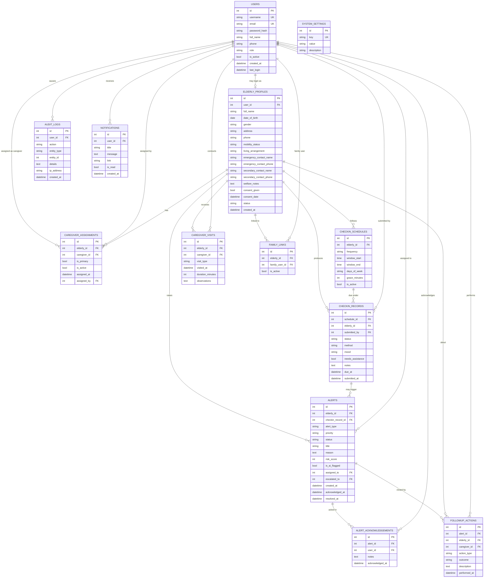

# Entity-Relationship Diagram and Database Design

## 1. Design principles

- Every table has a surrogate integer primary key (`id`).
- Foreign keys use `ON DELETE RESTRICT` for people and history (we deactivate; we do not cascade-delete welfare records).
- Passwords are never stored in plain text (`password_hash` only).
- Soft flags (`is_active`) preserve history.
- Check-in uniqueness for automatic missed rows: one record per `(elderly_id, due_at)` for scanner-created rows.
- SQLite types are used in the prototype. A MySQL-oriented script is also supplied.

## 2. Entity-Relationship Diagram

## 3. How the tables relate (plain language)

1. **users** holds every login account and its role.
2. **elderly_profiles** holds the household welfare record. It *may* point at a user who logs in as the elderly person.
3. **family_links** connects a `family` user to one or more profiles they are allowed to check in for.
4. **caregiver_assignments** is the many-to-many link between caregivers and households. `is_primary` marks who receives the first alert.
5. **checkin_schedules** says when a check-in is expected.
6. **checkin_records** says what actually happened (completed, missed, completed_late).
7. **alerts** are raised from missed records, assistance requests, or pattern flags.
8. **alert_acknowledgements** is the history of who saw an alert.
9. **caregiver_visits** are physical or phone visits, with or without an alert.
10. **followup_actions** are the work that allows an alert to be closed.
11. **notifications** are in-app messages.
12. **audit_logs** record security-relevant actions.
13. **system_settings** stores escalation hours and similar configuration.

## 4. Constraints and validation

| Table | Constraint |
| --- | --- |
| users | `username` unique, `email` unique, `role` in (`admin`,`caregiver`,`elderly`,`family`), password_hash not null |
| elderly_profiles | `full_name` not null; active profiles should have `consent_given = 1` |
| caregiver_assignments | unique active pair (`elderly_id`,`caregiver_id`); application enforces a single primary |
| checkin_schedules | `window_end` after `window_start`; `frequency` in (`daily`,`weekly`); `grace_minutes` >= 0 |
| checkin_records | `status` in (`completed`,`missed`,`completed_late`,`cancelled`); `mood` in (`good`,`okay`,`unwell`, null) |
| alerts | `priority` in (`low`,`medium`,`high`,`critical`); `status` in (`open`,`acknowledged`,`escalated`,`resolved`,`false_alert`) |
| followup_actions | `outcome` not empty when used to close an alert |

Application-level rules (harder in SQLite CHECK alone):

- A caregiver may only read assigned profiles.
- An alert cannot move to `resolved` without a follow-up row, unless status is `false_alert` with a reason.
- Scanner will not insert a second missed record for the same `elderly_id` + `due_at`.

## 5. Password storage

Werkzeug `generate_password_hash(password, method="pbkdf2:sha256")` stores a salt and iteration count in `users.password_hash`. Verification uses `check_password_hash`. Plain passwords never appear in logs.

## 6. Privacy

- List queries for caregivers always join through `caregiver_assignments`.
- Welfare notes and emergency numbers are treated as sensitive: they appear only on authorised profile pages.
- Backup download is admin-only and is audit-logged.
